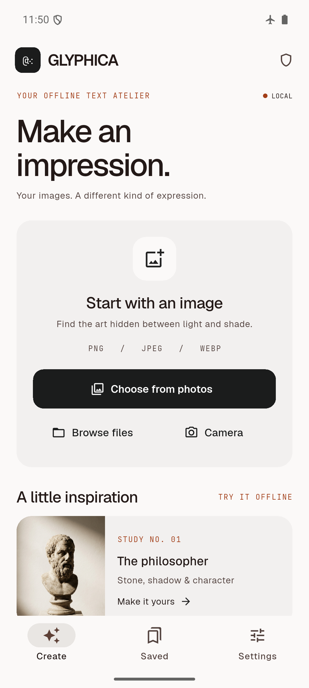
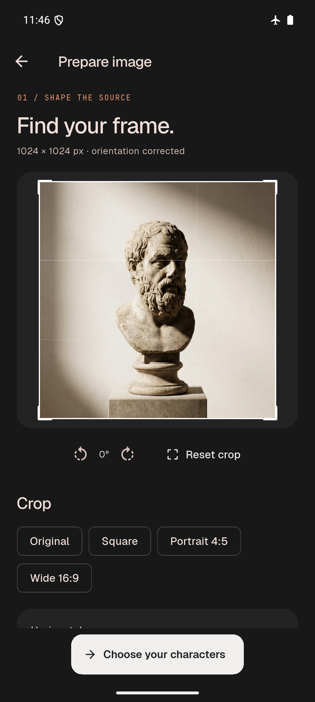
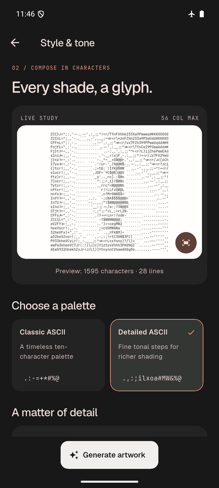
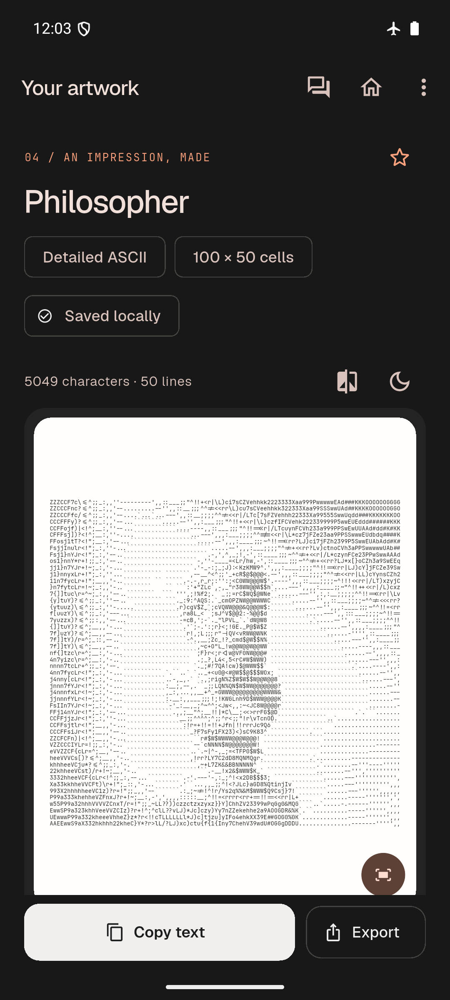
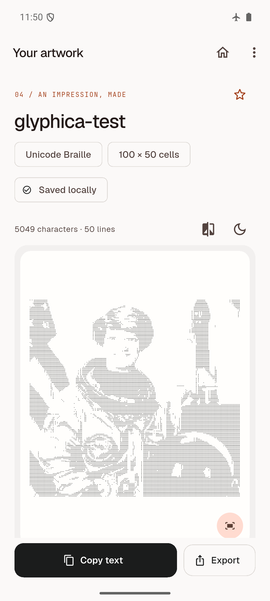
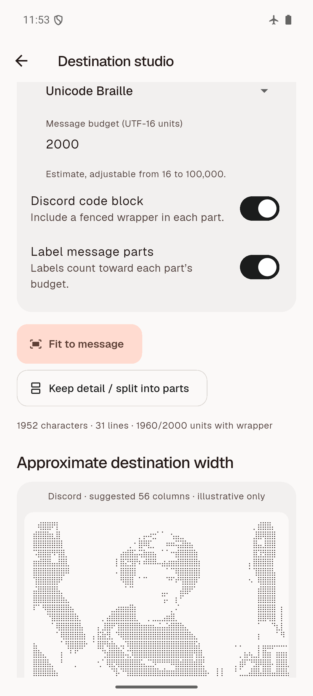
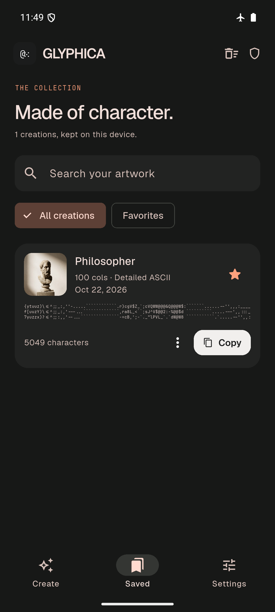
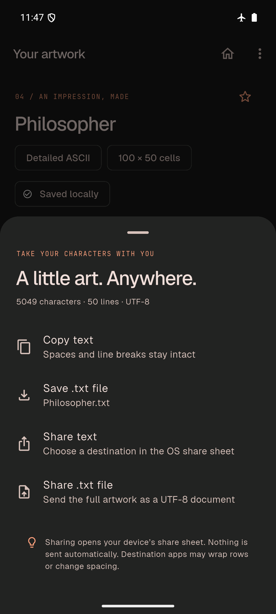

# Glyphica

A native Flutter image-to-text art studio. Turn photos into ASCII, Unicode blocks, or Braille, then save, copy, and share the result. Conversion, previews, and history run entirely on your device, with no account, image upload, analytics, or runtime downloads.

The supplied Stitch screens informed the warm paper surfaces, restrained rust accents, typography, palette cards, image preparation, artwork preview, and export sheet. The app uses real Flutter widgets and actual image processing. The reference HTML is not embedded.

## Screenshots

Real Android emulator captures from the offline validation recorded on **2026-10-22**, showing both light and dark themes. Select an image in GitHub to view it at full size.

| Create | Prepare image | Style and tone | ASCII artwork |
| :---: | :---: | :---: | :---: |
|  |  |  |  |

| Unicode Braille | Fit to message | Saved creations | Export and share |
| :---: | :---: | :---: | :---: |
|  |  |  |  |

See the [complete screenshot collection](docs/screenshots/) and [validation report](docs/VALIDATION.md) for picker, sharing, and offline workflow evidence.

## Features

- Import PNG, JPEG, or WebP, capture a photo on mobile, or use the bundled offline sample.
- Crop, rotate, correct character proportions, and adjust brightness, contrast, gamma, dithering, and edge detail.
- Choose Classic ASCII, Detailed ASCII, Unicode blocks, Unicode Braille, or a custom character ramp.
- Keep a local collection with search, favorites, rename, duplicate, and saved destination variants.
- Copy exact text or export UTF-8 `.txt` files while preserving spaces and line breaks.
- Fit artwork to an adjustable message budget or split it at complete line boundaries.

[Run the app](#run) · [Workflow](#use) · [Verification](#verification) · [Repository contents](#repository-contents) · [Licenses and credits](docs/THIRD_PARTY.md)

## Run

Use Flutter **3.47.0 / Dart 3.13.0 or later compatible versions**. The lockfile records the package versions used here.

```powershell
flutter pub get
flutter run -d <android-device-id>
```

Android minimum: API 24. The development build uses Android SDK 36, AGP 9.1, and the Flutter-generated Gradle wrapper. Configure the SDK with Flutter/Android Studio and accept the relevant SDK licenses on your machine. No secret environment variables or service configuration are required.

```powershell
flutter build apk --release
flutter run -d windows
flutter build windows --release
```

Windows needs Visual Studio with Desktop development with C++ and a Windows SDK. Distribute the **entire** `build/windows/x64/runner/Release/` folder, including `data/` and DLLs. Camera capture is offered on Android/iOS; Windows photo import uses the native file picker.

An iOS host is included, targeting iOS 15+. Build and sign it on macOS with Xcode; the photo-library and camera usage descriptions are configured. iOS builds and native picker/share behavior were not validated on this Windows host. Web is intentionally not configured: this implementation uses durable native files and SQLite.

The APK uses the standard **debug signing key for local evaluation**, including release-mode builds. Configure your own release signing before store distribution; no publishing credentials are bundled.

## Use

1. Enter the studio and import PNG, JPEG, or WebP from Photos or Files, capture a photo, or try the bundled philosopher.
2. Rotate, choose a centered crop preset or adjust both crop ranges, and select a white/gray/black transparency matte.
3. Compare silhouette, smooth-shading, and dense-detail studies. Select Classic ASCII, Detailed ASCII, Unicode blocks, Unicode Braille, or a custom light-to-dense ramp. Adjust width, cell aspect, brightness, contrast, gamma, inversion, dithering, and edge enhancement.
4. Generate the final artwork. It is automatically saved with an owned source image, thumbnail, exact text, dimensions, settings, and creation time.
5. Zoom/pan the unwrapped preview. Copy original text, save UTF-8 `.txt`, share text, or share a `.txt` document. Native save cancellation and failures are reported accurately.
6. Open “Where will you paste this?” for a separate destination variant. Fit to one message, or keep the original detail and split at full row boundaries. Copy individual parts or export the complete original. Save variants separately.
7. Reopen, search, rename, favorite, duplicate, share, export, or delete creations from Saved. Clear history requires confirmation. Missing source files leave saved text and variants usable.

Copy and export do **not** trim, reflow, normalize, or remove trailing spaces. Counts include line breaks. Character counts are exact Unicode code points; budgets conservatively count UTF-16 units. UTF-8 exports have no BOM and preserve the generated LF line endings.

## Processing

`lib/features/conversion/engine.dart` is independent of Flutter widgets, storage, and destination logic:

1. Detect the encoded format and validate its header. Decode one frame with the pure Dart `image` package and bake EXIF orientation, including mirrored orientations supported by the decoder.
2. Apply quarter-turn rotation and normalized crop, then composite alpha onto the chosen matte **before** resampling, preventing hidden transparent RGB from leaking into edges.
3. Correct character-cell proportions: `rows = round(sourceHeight / sourceWidth × columns × cellAspect)`. Default cell aspect is 0.5. Use area averaging when downsampling and cubic interpolation when enlarging.
4. Compute linear-light Rec.709 luminance, re-encode to perceptual sRGB, apply brightness/contrast/gamma and optional inversion, then a capped unsharp mask.
5. Map darkness to measured ASCII glyph coverage or nominal Unicode block densities. Optional Floyd–Steinberg error diffusion operates on the quantization error. Custom ramps use the supplied light-to-dense order.
6. For Braille, sample a **2 × 4** grid per character and map dots to Unicode's 1/2/3/7 left-column and 4/5/6/8 right-column bits. The app bundles its own fixed-cell Braille fallback font so previews do not need a downloaded or installed symbol font.
7. Emit complete, equal-width rows, including meaningful spaces.

Input limits: **24 MiB encoded**, **16 megapixels**, 16,000 pixels per side. Output: 8–240 columns and at most 160,000 cells. The style screen starts at 16 columns; Fit can go down to 8. Animated PNG/WebP uses the first frame. HEIC/HEIF, RAW, GIF, TIFF, SVG, and PDF are not offered. The actual decoder must accept an encoding; an extension alone is never treated as proof of support.

Inspection and rendering run in killable worker isolates. Live controls debounce for 350 ms, cancel superseded workers, and discard results with old generation tokens. The live preview uses at most 56 columns, comparisons use 40, and Generate renders the requested width. A cancelled conversion does not save a partial result. Once final persistence begins, the progress screen briefly prevents cancellation/back navigation to finish the save atomically.

This is not lossless conversion. More columns improve spatial detail while increasing message length approximately quadratically. Thin lines, fur, facial detail, low-contrast backgrounds, and clipped shadows remain limited by source quality and output resolution. See [visual review and limitations](docs/QUALITY_REVIEW.md) and [comparison sheets](docs/quality/).

## Destination profiles

Edit [`assets/config/destinations.json`](assets/config/destinations.json). It contains all seven requested destinations: Instagram DMs, Facebook, WhatsApp, Discord, X DMs, Messenger, and generic plain text. Each defines suggested width, ASCII/Unicode preference, an adjustable budget, whitespace guidance, and wrapper support. Users can override width, mode, budget, labels, and splitting decisions in the app.

**All numerical budgets and suggested widths are compatibility estimates, not verified platform maxima.** No claim is made that other apps preserve spaces, support monospace, or render Unicode identically. No social login or direct sending is implemented. The preview illustrates width and permits horizontal inspection; it is not a replica of a third-party app.

Only Discord offers a fenced code-block wrapper here, based on its [official formatting documentation](https://support.discord.com/hc/en-us/articles/210298617-Markdown-Text-101-Chat-Formatting-Bold-Italic-Underline), checked on 2026-10-22. The other profiles deliberately send plain text without unsupported formatting assumptions. Unicode appearance, account tiers, client versions, and paste behavior need testing in the receiving app.

Fit re-renders from the source image at a lower width. Keep detail uses the original artwork. Splits preserve every row and include wrapper/optional part-label overhead in each budget. A single row that cannot fit produces an actionable error. Joining raw part bodies with LF reconstructs the full artwork exactly. A ramp containing triple backticks cannot use the code-fence wrapper. Separate messages may interrupt visual continuity.

## Storage and architecture

```text
lib/core/                       App state, theme, exact clipboard/UTF-8 output
lib/features/conversion/        Pure engine, settings, worker lifecycle, editing screens
lib/features/destinations/      Config model, line-safe formatting, variants UI
lib/features/history/           SQLite repository, saved models, collection UI
lib/features/home/             Welcome and studio imports
lib/features/export/           Native save/share actions
lib/features/settings/         Appearance, reduced motion, compatibility help
lib/shared/                    Native UI components and unwrapped art canvas
```

Riverpod supplies the application controller; go_router connects screens. SQLite uses `sqflite` on Android/iOS and `sqflite_common_ffi` on Windows. The database lives under the application-support `Glyphica/` directory. Sources and PNG thumbnails are owned by the app and referenced with relative filenames so picker cache paths and iOS container relocation do not break history. Duplicates share an owned source until the final referencing creation is deleted. Abandoned imports older than 24 hours are cleaned on startup. Uninstall removes local storage; `.txt` export is the portable backup.

Application code makes no network requests. Android release requests no Internet permission and disables Android backup. OS-level providers or sharing destinations are external to this app; select locally stored images when offline. iOS system backup policy remains managed by the operating system.

## Verification

```powershell
dart format --output=none --set-exit-if-changed lib test integration_test tool
flutter analyze
flutter test
flutter test integration_test/offline_workflow_test.dart -d <android-device-id>
flutter build apk --release
flutter build windows --release
```

The automated suite covers orientation, cell proportions, crop/rotation order, PNG/JPEG/WebP decoding, calibrated mapping, all eight Braille bit positions, transparency, brightness/gamma, area resampling, consistent rows, meaningful whitespace, Unicode-safe splitting, wrapper/label overhead, long-row refusal, durable source ownership/history, database restart, saved variants, cancellation, stale-result rejection, missing-source recovery, and fit-to-budget rendering.

The Android integration test uses isolated temporary app data and the bundled sample, avoiding dependence on a human picker selection. It runs import → preparation → final conversion → automatic save → clipboard comparison → UTF-8 file comparison → fresh database/controller reopen → result reopen. Native Photos/Files pickers, the save document picker, and share sheets are checked separately in the emulator smoke report.

Completed checks and device evidence are recorded in [VALIDATION.md](docs/VALIDATION.md). Emulator checks are not physical-device performance or exact social-app rendering acceptance.

If a release build reports a missing `integration_test` class after tests, build **without `--no-pub`**. This Flutter toolchain has a [documented development-plugin registration issue](https://github.com/flutter/flutter/issues/169336). The normal release build regenerates the filtered registrant; no test dependency needs moving into production dependencies. Avoid concurrent Flutter builds or `pub get` operations in the same checkout, because generated plugin files are shared.

Developer-only font/quality regeneration (Python with Pillow and fontTools):

```powershell
python -m pip install pillow fonttools
python tool/calibrate_ramps.py
python tool/build_dot_font.py
python tool/build_icons.py
python tool/quality_fixtures.py
dart run tool/quality_report.dart
python tool/render_quality.py
```

All runtime fonts and the source sample are bundled. Font, fixture, and reference-image provenance is in [THIRD_PARTY.md](docs/THIRD_PARTY.md).

## Repository contents

| Path | Contents |
| --- | --- |
| `lib/` | Flutter application and local image-processing engine |
| `assets/` | Bundled fonts, licenses, sample image, and destination profiles |
| `android/`, `ios/`, `windows/` | Native platform hosts |
| `test/`, `integration_test/` | Automated checks and image fixtures |
| `docs/` | App screenshots, validation record, visual comparisons, and credits |
| `tool/` | Font, icon, fixture, quality-report, export-verification, and packaging scripts |

Keep `pubspec.lock`, `.metadata`, test fixtures, font licenses, and native host source in version control. Build caches, local SDK paths, IDE settings, logs, signing files, and packaged releases are excluded by `.gitignore`.

## Release packaging

After building both the Android and Windows releases, generate local delivery files with:

```powershell
python tool/package_delivery.py
```

The script creates an evaluation APK, a complete Windows release ZIP, a Flutter source ZIP, and `SHA256SUMS.txt` under `dist/`. This generated directory is excluded from Git. Distribute binaries as release assets separately from the source repository. The APK uses debug signing until you configure your own release key, as described above.
